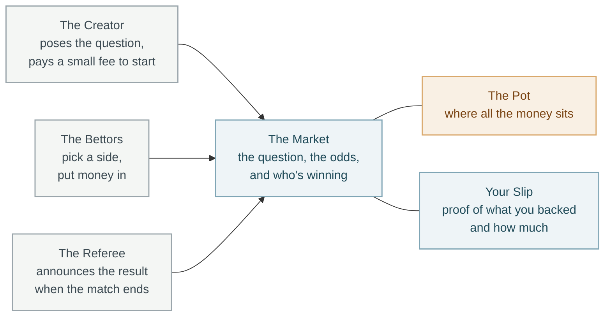
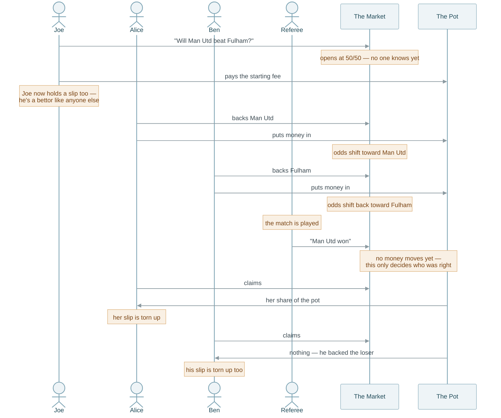
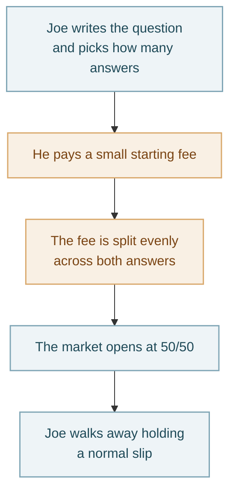
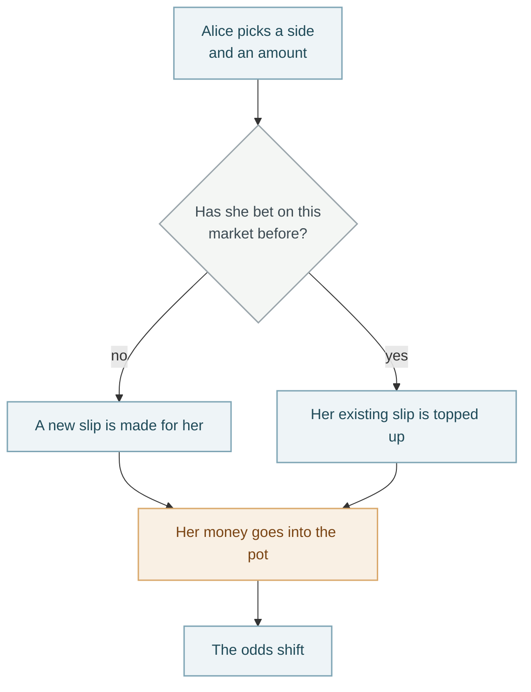
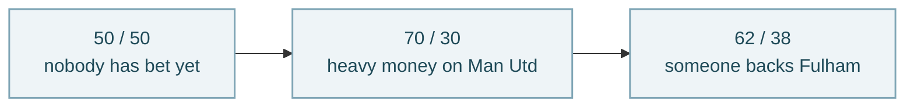
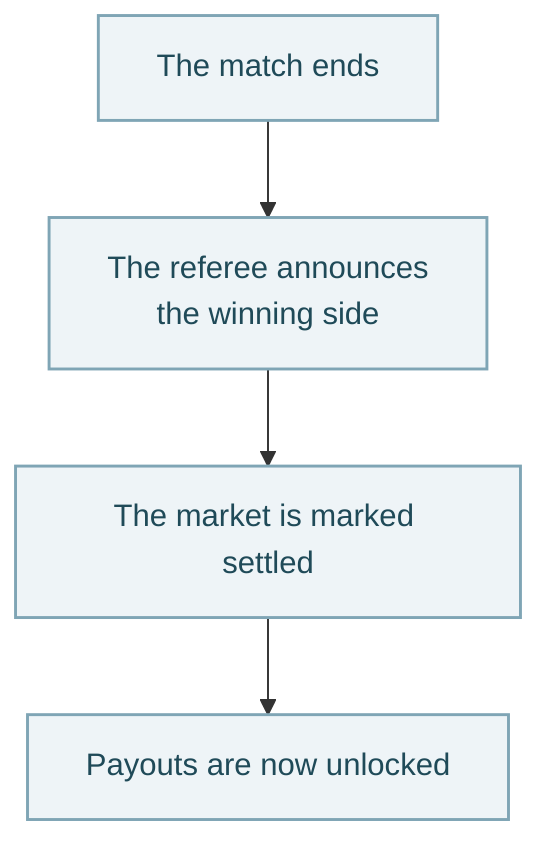
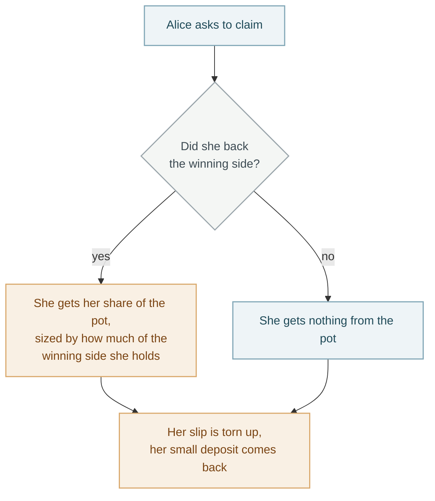

# How Openstake Works

A plain-language walkthrough of the settlement engine. No code knowledge
needed. The technical version lives in `arch/USER_FLOWS.md`.

---

## The idea in one paragraph

Someone poses a question with two possible answers — *will Man Utd beat
Fulham?* People put money on the answer they believe. All that money goes
into one pot. When the real-world result comes in, everyone who backed the
right answer splits the pot between them, in proportion to how much they
put in and how early they got in. Nobody is betting against the house.
There is no house. Everyone is betting against each other.

---

## The cast

Three people, three things. **The Market** holds the question and the
current odds. **The Pot** holds the actual money. **Your Slip** is your
personal record — what you backed, how much of the pot you're entitled to
if you're right.

---

## The full journey

One market, beginning to end.

**The thing to notice:** money goes in twice (Joe's fee, then each bet) and
comes out once (claiming). The referee's announcement moves no money at
all — it only settles the question of who was right. Losers still claim;
they just get nothing back except the small deposit they paid to hold a
slip in the first place.

---

## Joe creates a market

**Why the fee is split evenly:** if it all went on one side, the market
would open already leaning that way — and the first person to bet could
take advantage of that. Splitting it down the middle means the market
starts with genuinely no opinion.

**Joe gets no special treatment afterward.** He holds a slip on both
answers, exactly like anyone who'd bet that same amount. He can't cancel
the market, can't withdraw his fee, and doesn't decide the result.

---

## Someone places a bet

**Once money is in, it stays in.** There's no way to change your mind and
pull out. The only way to get money back is to be right when the result
comes in.

---

## How the odds move

Nobody sets the odds. They come out of how much money is on each side.

Two things follow from this, and both matter:

**Betting on the popular side gets you less.** If most money is already on
Man Utd, you're splitting the pot with more people, so your share is
smaller. Backing the unpopular side pays more if you're right — that's the
whole reason odds exist.

**Big bets move the price against themselves.** Put in a lot at once and
the odds shift while you're buying, so the last part of your bet gets a
worse rate than the first part. That's normal for any market — it's the
same reason selling a large amount of anything moves the price.

**Early on, this effect is strongest**, because there's very little money
in the pot yet and each new bet is a big fraction of it. The engine softens
this by treating the pot as if it's a bit larger than it really is when
working out odds — a cushion, so the first few bettors don't get hit as
hard by their own size. That cushion is only used for working out odds. It
is never real money, and it never affects what anyone gets paid.

---

## The result comes in

**Only one specific person can do this**, decided when the market was
created. Not the creator, not a bettor, not anyone who happens to be
watching. And it can only happen once — a settled market can't be settled
again with a different answer.

**No money moves at this step.** It only records who was right, which
unlocks the claiming step.

---

## Getting paid

**Your share** is straightforward: if you hold a tenth of all the winning
bets, you get a tenth of the pot. Everyone who was right divides the whole
pot between them, including the money the losers put in.

**You can only claim once.** The slip is marked and torn up in the same
step, so nobody can be paid twice for the same bet.

**Losers should still claim.** They get nothing from the pot, but they do
get back the small deposit that was charged to hold a slip in the first
place.

---

## The promise underneath all of this

**The pot never pays out more than went into it.** Not "shouldn't" —
can't. There's no formula that could produce a payout larger than the
money available, because payouts are always shares of a fixed pot, never
amounts calculated independently.

Before paying anyone, the engine checks that the money actually sitting in
the pot matches what its records say should be there. If those two numbers
ever disagree — by even a small amount — it refuses to pay out at all
rather than guess which one is right.

**Everything is checked before it's trusted.** Every time someone claims,
bets, or settles, the engine verifies that each thing handed to it really
is what it claims to be, really belongs to this market, and really belongs
to the person asking. Something in the wrong slot gets rejected outright,
not quietly misread.

---

## What isn't built yet

- **You can't sell your slip to someone else.** Once you're in, you're in
  until the result comes in. Trading slips between people is a later phase.
- **The referee is a fixed, trusted person**, not an automatic feed of
  real-world results. Replacing that with something automatic is a
  separate piece of work.
- **Markets have exactly two answers.** More than two is supported by the
  design but not switched on.

---

*Reflects the engine as currently built. The technical version, with the
actual account names and instruction details, is in `arch/USER_FLOWS.md`.*
